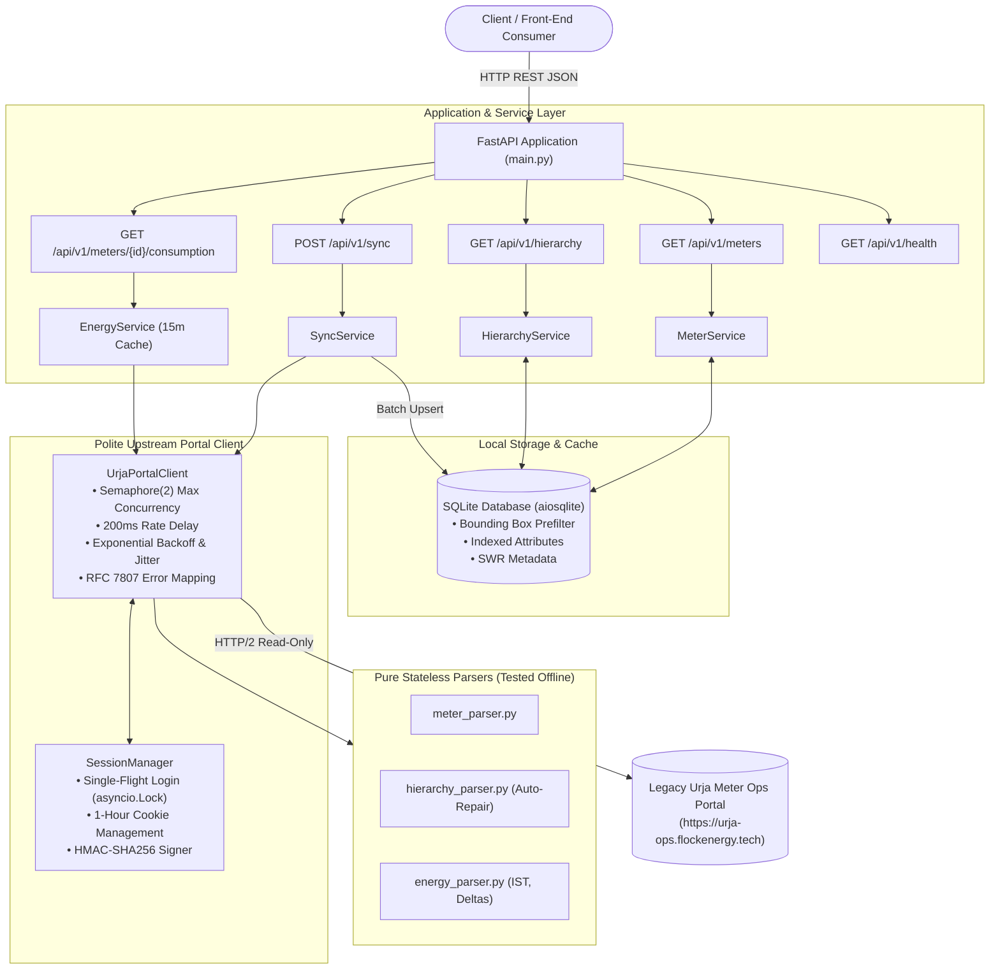

# Urja Meter Ops API Service

[](https://www.python.org/downloads/)
[](https://fastapi.tiangolo.com)
[](https://docs.pydantic.dev/)
[](tests/)
[](LICENSE)

A production-grade, resilient RESTful API and synchronization service built in front of the legacy **Urja Meter Ops** smart-metering web portal.

The service provides clean, normalized, and typed programmatic access to meter metadata, 7-tier distribution network hierarchy, geospatial lookups, and 30-minute interval telemetry load curves without placing unnecessary load on the upstream portal.

---

## Architecture Overview



---

## Key Features

1. **Undocumented Bulk Synchronization**:
   - Reconstructed the portal's HMAC-SHA256 signature protocol discovered in Vite client bundles (`/portal/export`).
   - Synchronizes all **403 meters** and **40 distribution transformers** in a single polite ~250ms request, bypassing 20+ sequential paged scrapes.
2. **Polite, Resilient Client**:
   - Strictly bounded concurrency (`asyncio.Semaphore(2)`), 200ms inter-request pacing, and bounded retries with jitter.
   - **Single-Flight Session Management**: Concurrent requests encountering an expired session wait on an `asyncio.Lock()` so only one login request reaches the upstream portal.
   - Transparent upstream error mapping to **RFC 7807 Problem Details** (`application/problem+json`).
3. **Data Quality & Automated Repair**:
   - Quantified census across all 403 meters revealed **22 meters (5.46%)** with asymmetric missing hierarchy names or codes.
   - Inferred missing fields from network peer nodes while surfacing explicit `DataQualityWarning` flags in API responses.
   - 100% coordinate cleanliness verified (all 403 meters within Jaipur metropolitan bounds: Lat 26.78–27.04, Lng 75.66–75.91).
4. **Fast Geospatial Radius Querying**:
   - Two-phase spatial search: indexed SQL bounding-box prefilter + exact Python Haversine calculation with distance sorting.
5. **Normalized Telemetry & Energy Semantics**:
   - Telemetry parsed into timezone-aware **IST (UTC+05:30)** ISO-8601 timestamps.
   - Differentiates cumulative counter registers (`kwh`, `kvah`) from calculated interval consumption deltas ($\Delta\text{kWh}$).
6. **Zero-Build Operations Console**:
   - Single-page dashboard served at `/ui` featuring Leaflet geospatial distribution map, Chart.js 30-min load curve, and search filters.

---

## Quickstart & Installation

### Prerequisites
- Python 3.11+ (tested on Python 3.14.2; 3.11+ expected)
- `uv` (recommended) or standard `python3 -m venv`

### 1. Clone & Configure
```bash
git clone https://github.com/flock-energy/takehome.git urja-api
cd urja-api

# Create your local environment configuration
cp .env.example .env
```
Edit `.env` to include your portal credentials:
```ini
URJA_PORTAL_BASE_URL=https://urja-ops.flockenergy.tech
URJA_PORTAL_USERNAME=your_operator_email
URJA_PORTAL_PASSWORD=your_portal_password
PORT=8000
```

### 2. Install Dependencies
Using `uv`:
```bash
uv venv .venv
source .venv/bin/activate
uv pip install -e . -r <(echo -e "pytest>=9.0.0\npytest-asyncio>=1.4.0\nrespx>=0.23.0\nruff>=0.17.0")
```
Or using standard `pip`:
```bash
python3 -m venv .venv
source .venv/bin/activate
pip install -e . pytest pytest-asyncio respx ruff
```

### 3. Run the Service
```bash
make run
# or directly:
.venv/bin/uvicorn src.urja_api.main:app --host 0.0.0.0 --port 8000 --reload
```

#### Cold Start & Automatic Startup Synchronization
On initial boot (`make run`), the service inspects the local SQLite database. If the database is unseeded and portal credentials are provided in `.env`, the service initiates an initial bulk synchronization during startup lifespan, indexing all 403 meters and distribution transformers before serving traffic. If queries arrive before synchronization completes, endpoints like `/api/v1/meters` and `/api/v1/hierarchy` lazily trigger synchronization on first access.
`/api/v1/health` reports `status: "healthy"` once the index is populated. It only reports `status: "degraded"` for legitimate operational reasons: when the upstream portal is temporarily unreachable (while cached data remains available for reads) or when cache staleness exceeds configured TTLs.

The service is now running at `http://localhost:8000`:
- **Interactive OpenAPI Documentation**: `http://localhost:8000/docs`
- **ReDoc API Spec**: `http://localhost:8000/redoc`
- **Zero-Build Web Console**: `http://localhost:8000/ui`
- **Health & Readiness Check**: `http://localhost:8000/api/v1/health`

---

## API Documentation & Core Endpoints

| Endpoint | Method | Description | Cache / Headers |
|---|---|---|---|
| `/api/v1/meters` | `GET` | List/filter meters (make, phase, status, DT, spatial radius `near_lat`/`near_lng`/`radius_km`). | `X-Cache: HIT/MISS`, `X-Data-Fetched-At` |
| `/api/v1/meters/{id}` | `GET` | Retrieve complete meter details, nameplate attributes, and hierarchy links. | `X-Cache: HIT/MISS` |
| `/api/v1/meters/{id}/consumption` | `GET` | 30-minute interval telemetry series, cumulative registers, and window summary. | `X-Cache: SWR` (15m TTL) |
| `/api/v1/hierarchy` | `GET` | Full 7-tier network tree with rolled up meter counts at every node. | `X-Cache: HIT` (1h TTL) |
| `/api/v1/hierarchy/nodes/{id}` | `GET` | Node detail view with full ancestor path and immediate children. | `X-Cache: HIT` |
| `/api/v1/sync` | `POST` | Trigger bulk synchronization into SQLite index (cooldown rate-limited). | -- |
| `/api/v1/health` | `GET` | Service operational health, upstream reachability, latency, and cache age. | -- |

### Sample Request & Response

#### 1. Geospatial Radius Search (List View)
`GET /api/v1/meters?near_lat=26.9124&near_lng=75.7873&radius_km=3.0&limit=1`

```json
{
  "data": [
    {
      "meter_id": "J100368",
      "serial_number": "L&37528",
      "make": "HPL",
      "phase_type": "three",
      "install_status": "Faulty",
      "install_type": "Whole Current",
      "build_version": "legacy",
      "dt_code": "DT-009",
      "location": {
        "latitude": 26.916888334176132,
        "longitude": 75.78477906508856,
        "distance_km": 0.558
      },
      "hierarchy": {
        "zone": {
          "code": "Z-03",
          "name": "Jaipur Zone 3",
          "raw_code": "Z-03",
          "raw_name": "Jaipur Zone 3",
          "is_inferred": false
        },
        "circle": {
          "code": "C-03",
          "name": "Circle 3",
          "raw_code": "C-03",
          "raw_name": "Circle 3",
          "is_inferred": false
        },
        "division": {
          "code": "D-09",
          "name": "Division 9",
          "raw_code": "D-09",
          "raw_name": "Division 9",
          "is_inferred": false
        },
        "subdivision": {
          "code": "SD-09",
          "name": "Subdivision 9",
          "raw_code": "SD-09",
          "raw_name": "Subdivision 9",
          "is_inferred": false
        },
        "substation": {
          "code": "SS-09",
          "name": "Substation 9",
          "raw_code": "SS-09",
          "raw_name": "Substation 9",
          "is_inferred": false
        },
        "feeder": {
          "code": "F-009",
          "name": "Feeder 9",
          "raw_code": "F-009",
          "raw_name": "Feeder 9",
          "is_inferred": false
        },
        "dt": {
          "code": "DT-009",
          "name": "Sikar Road DT 9",
          "raw_code": "DT-009",
          "raw_name": "Sikar Road DT 9",
          "is_inferred": false
        }
      },
      "data_quality_warnings": []
    }
  ],
  "pagination": {
    "total_records": 16,
    "page": 1,
    "limit": 1,
    "total_pages": 16,
    "has_next": true,
    "has_prev": false
  },
  "data_quality_warnings": []
}
```

#### 2. Meter Detail View
`GET /api/v1/meters/J100368`

```json
{
  "meter_id": "J100368",
  "serial_number": "L&37528",
  "make": "HPL",
  "phase_type": "three",
  "install_status": "Faulty",
  "install_type": "Whole Current",
  "build_version": "legacy",
  "dt_code": "DT-009",
  "location": {
    "latitude": 26.916888334176132,
    "longitude": 75.78477906508856,
    "distance_km": null
  },
  "hierarchy": {
    "zone": {
      "code": "Z-03",
      "name": "Jaipur Zone 3",
      "raw_code": "Z-03",
      "raw_name": "Jaipur Zone 3",
      "is_inferred": false
    },
    "circle": {
      "code": "C-03",
      "name": "Circle 3",
      "raw_code": "C-03",
      "raw_name": "Circle 3",
      "is_inferred": false
    },
    "division": {
      "code": "D-09",
      "name": "Division 9",
      "raw_code": "D-09",
      "raw_name": "Division 9",
      "is_inferred": false
    },
    "subdivision": {
      "code": "SD-09",
      "name": "Subdivision 9",
      "raw_code": "SD-09",
      "raw_name": "Subdivision 9",
      "is_inferred": false
    },
    "substation": {
      "code": "SS-09",
      "name": "Substation 9",
      "raw_code": "SS-09",
      "raw_name": "Substation 9",
      "is_inferred": false
    },
    "feeder": {
      "code": "F-009",
      "name": "Feeder 9",
      "raw_code": "F-009",
      "raw_name": "Feeder 9",
      "is_inferred": false
    },
    "dt": {
      "code": "DT-009",
      "name": "Sikar Road DT 9",
      "raw_code": "DT-009",
      "raw_name": "Sikar Road DT 9",
      "is_inferred": false
    }
  },
  "data_quality_warnings": [],
  "nameplate_attributes": {}
}
```

#### 3. RFC 7807 Error Response
`GET /api/v1/meters/UNKNOWN_METER`

```json
{
  "type": "https://api.urja-ops.local/errors/not_found",
  "title": "Resource Not Found",
  "status": 404,
  "detail": "Meter 'UNKNOWN_METER' was not found.",
  "instance": "/api/v1/meters/UNKNOWN_METER",
  "code": "NOT_FOUND"
}
```

---

## Testing & Verification

The test suite covers offline parser verification, upstream failure mocking, spatial queries, and live end-to-end smoke verification:

```bash
# Run complete offline test suite (21 tests)
make test

# Run code style and formatting checks
make lint

# Run live smoke test against live portal (verifies real portal output)
make test-live
```

### Test Suite Structure
- `tests/test_parsers.py`: Unit tests verifying pure parser functions against captured real fixtures (`tests/fixtures/`).
- `tests/test_hierarchy.py`: Tests tree reconstruction, meter count rollups, and intentional handling of messy hierarchy data.
- `tests/test_api_mocked.py`: Comprehensive API tests with mocked portal upstream (`respx`):
  - Session expiration & single-flight re-login.
  - Upstream 502/504 error mapping.
  - Spatial radius search and sorting.
  - Pagination and cross-attribute filtering.
- `tests/test_openapi.py`: Ensures committed `openapi.json` is never stale or out of sync with the codebase.
- `tests/test_live_smoke.py`: Live read-only smoke test against the actual portal (guarded by `ENABLE_LIVE_PORTAL_TESTS=true`).

---

## Cache TTL Policy & Staleness Rules

> **Empirical Context**: During reverse-engineering investigation, the upstream portal data remained static (`total: 403` meters, telemetry fixed up to 30/06/2026) **[OBSERVED]**. TTL configurations reflect realistic operational utility parameters:

| Resource Type | Cache Location | Default TTL | Staleness / SWR Policy | Justification & Observed vs Assumed Context |
|---|---|---|---|---|
| **Meter Metadata & Hierarchy** | SQLite Index | **1 Hour** (3,600s) | Stale-While-Revalidate up to 24 hours (`X-Cache: HIT`, `X-Data-Fetched-At`) | Structural distribution network master data (zones, substations, feeders, transformers) changes infrequently in power utilities **[ASSUMED]**. |
| **Consumption Telemetry** | In-Memory TTL Cache | **15 Minutes** (900s) | Re-fetched on expiry; cached per `(meter_id, from, to)` window | Telemetry is sampled at 30-minute block intervals for active meters **[OBSERVED]**. A 15-minute TTL guarantees fresh readings at half the collection cadence without query storms **[ASSUMED]**. |
| **Manual Sync Route** | `POST /api/v1/sync` | Cooldown: **60 Seconds** | Returns HTTP 429 if triggered within cooldown period | Protects upstream `/portal/export` from flooding or denial-of-service from repeated client sync requests **[OBSERVED polite client requirement]**. |
| **Portal Session Token** | Memory (`SessionManager`) | **50 Minutes** (buffer before 60m expiry) | Single-flight re-login on 302 redirect or token expiry | Upstream cookie `__Secure-better-auth.session_token` has `Max-Age=3600` **[OBSERVED]**. A 50-minute renewal prevents mid-flight session expiration. |

---

## Assumptions & Design Decisions

| Category | Decision / Assumption | Justification |
|---|---|---|
| **Bulk Path** | Use HMAC-signed `/portal/export` endpoint discovered in client chunks | Synchronizes all 403 meters in 1 request (~250ms) vs. 21+ sequential paged scrapes. |
| **Export Resilience** | Secret invalidation retry + automatic fallback to paged search crawl | If `/portal/export` returns 401/403, the client invalidates the cached secret and retries once; if persistent failure occurs, it falls back to paginating `/portal/meters/search`. The fallback captures 100% of meters (403/403) and master fields, but has partial hierarchy (DT only) and lacks geo-coordinates without individual lookups. See [PROTOCOL.md §3.1.2](PROTOCOL.md). |
| **Hierarchy Tiers** | Full 7-tier topology on both list and detail views | Both `MeterSummary` (list) and `MeterDetail` (detail) expose all 7 tiers (`zone`, `circle`, `division`, `subdivision`, `substation`, `feeder`, `dt`). This prevents N+1 queries by allowing API consumers to group, aggregate, or slice search results by substation or feeder without needing individual detail calls. The detail view additionally returns extended `nameplate_attributes`. |
| **Data Repair** | Inferred missing hierarchy codes/names from peer nodes with `data_quality_warnings` | Prevents broken tree visualization while preserving full auditability of upstream anomalies. |
| **Storage** | SQLite (`aiosqlite`) with bounding-box prefilter | Embedded, zero external dependencies, sub-millisecond query latency for regional utility datasets. |
| **Concurrency** | Polite client bounded to 2 concurrent in-flight requests | Prevents denial of service or disruption on legacy utility portal. |
| **Timezone** | All timestamps normalized to IST (UTC+05:30) | Utility is located in Jaipur, Rajasthan. Standardizes telemetry across consumers. |

For detailed protocol analysis and wire specifications, refer to [PROTOCOL.md](PROTOCOL.md).  
For the committed API contract, see [openapi.json](openapi.json).  
For the detailed engineering reflection, see [REFLECTION.md](REFLECTION.md).

---

## AI-Use Disclosure

- **Tools Used**: Gemini 3.8 Flash (High) via Antigravity agentic coding assistant was utilized as a senior pair programmer for reverse-engineering investigation, architecture implementation, test authoring, and documentation. Claude (Anthropic) was used to draft and review the initial agent prompt.
- **Verification Strategy**: Zero claims were accepted without empirical execution. Every single portal wire format, endpoint behavior, and edge case was empirically probed against the live portal, captured into `docs/evidence/`, saved as offline fixtures in `tests/fixtures/`, and verified with automated test suites passing locally.
